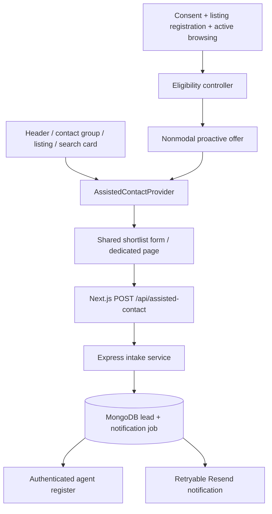

# Assisted contact: implementation plan

**Prepared:** 29 October 2026 (Africa/Lagos). **Status:** proposed implementation; application code has not been changed.

Implement one reusable shortlist-request flow in the existing Next.js frontend, accessible whenever a visitor wants help. Add an immediate inline offer to verified empty searches. Once consent, lead storage and agent handling are working, experiment with a small proactive panel after two distinct listing views and 90 seconds of estimated active browsing.

The initial service is a human-prepared shortlist from Bukunmi, not an automatically generated recommendation engine. A successful submission means the request was durably recorded; it does not mean a prospect has been qualified or a shortlist delivered.

## 1. Scope and current-code findings

This plan implements section 7 of [ONLINE_MARKETING_STRATEGY_REPORT.md](C:/Users/HP/source/repos/Real_Estate/Transcendent_Realty/ONLINE_MARKETING_STRATEGY_REPORT.md). It uses the current working files, including existing local modifications, rather than assuming every finding in the older report remains unresolved.

Frontend paths below are relative to `C:/Users/HP/source/repos/Real_Estate/Transcendent_Realty/lagos_property_center_frontend/`. Backend/admin paths are relative to the sibling `lagos_property_center_backend_and_admin/` directory.

| Existing code | Current behavior and implementation implication |
|---|---|
| `package.json`, `src/app/layout.tsx` | Next.js 14.2.3 App Router, React 18, TypeScript, Bootstrap/React Bootstrap and SCSS already exist. Add a client provider inside the existing server layout; keep listing/search data fetching on the server. |
| `src/components/user/layout/FloatingWhatsAppButton.tsx` | Shared floating call/WhatsApp controls already render immediately by default and support either configured number. Extend their layout for a text assistance action instead of introducing a competing floating stack. |
| `src/components/user/layout/NavigationLinks.tsx`, `Footer.tsx` | Provide navigation/footer entry points to the same request flow. The persistent assistance action must still render if neither telephone environment variable is configured. |
| `src/app/listing/[id]/page.tsx` | Successful listing output already includes `data-listing-id`/title and working contact actions. Add an explicit client listing-context registration component after successful data resolution; do not count property-card impressions, prefetched routes or failed listings. |
| `src/components/user/search/SearchResultsPage.tsx`, `SearchResults.tsx` | Search is server-fetched, has an explicit error flag and client navigation via URL filters. Preserve those improvements. Add explicit `idle`, `loading`, `success` and `error` result states to distinguish an unsubmitted AI search from a completed empty search. |
| `src/components/user/search/PropertyResultsGrid.tsx`, `SearchContactHelp.tsx` | Empty arrays currently show an empty-state message and direct contact buttons. `SearchContactHelp` is also used in the error branch. The new immediate empty-search offer must be selected by successful search state and total count, not merely by this component's presence or array length. |
| `src/lib/measurement.ts` | All main call/WhatsApp buttons share `trackContact`, but it has no local suppression signal. Analytics event/parameter allowlists need explicit extensions. Existing Google Ads click conversions use legacy USD 35 values; do not copy those values onto shortlist submissions. |
| `src/components/user/layout/JourneyMeasurement.tsx` | Measures visible-page elapsed time using `Date.now()`. It has no recent-interaction idle cutoff and cannot supply the proposed active-browsing threshold unchanged. |
| `src/lib/measurement.ts`, `CookieConsentModal.tsx`, `src/app/layout.tsx`, `Footer.tsx` | `readConsent()` currently returns both categories granted; consent mapping/initialization also grants consent unconditionally. Consent panel and footer preferences are commented out. Restore effective choices before collecting cross-page eligibility state or enabling proactive prompts. |
| `src/app/api/contact/route.ts`, `ContactHeroForm.tsx` | Current form requires five inputs in the UI; server checks four for presence and sends through Resend. No durable lead storage, idempotency or form-specific anti-abuse controls were found in that route. Do not use email success as the new lead record. |
| Backend `backend/models`, `backend/app.js`; admin `admin_client/src/App.tsx` | MongoDB/Mongoose and authenticated admin UI exist, but no lead model/routes/resource were found in the inspected source. A durable intake and a minimal agent register are necessary companion changes outside the frontend. |

The frontend already contains local changes to layout, consent, footer, measurement and TypeScript configuration, plus a measurement backup. Preserve and review those edits during implementation; do not replace entire files with older versions. The parent workspace contains separate frontend/backend Git repositories.

### Delivery boundaries

- **Release A:** durable request handling, minimal agent register, shared form, manual entry points and contextual empty-search assistance. Tracking acceptance is not required to request help.
- **Release B:** restored consent behavior, active-browsing eligibility, suppression and the proactive-prompt holdout experiment.
- **Deferred:** automated shortlisting, a chatbot, WhatsApp Business messaging integration, OTP verification, broad CRM/replay systems and automated marketing sequences. Add these only if subsequent evidence warrants them.

## 2. Visitor experience

### Entry points and offer

Use the report's copy consistently:

> **Want help narrowing this down?**  
> Tell us your preferred area and budget. Bukunmi can suggest a short list of suitable properties and explain the next steps.  
> **Get a shortlist** · **Keep browsing**

| Surface | Planned behavior |
|---|---|
| Persistent contact group | Add a clearly labelled `Get a shortlist` button alongside the existing contact controls. Use a compact text action on mobile; reserve space so it cannot obscure pagination, forms or property facts. |
| Navigation and footer | Add an assistance action opening the same form, with `/get-a-shortlist` as a real fallback destination. Collapse the mobile navbar before opening the form. |
| Listing details | Add a secondary `Help me find similar properties` action below direct contact controls. Pass the listing ID, location, transaction type and property type as editable context. |
| Verified zero search results | Show the offer inline immediately, in both standard and AI search. Retain change-filters/retry paths and direct call/WhatsApp actions. No timer or tracking consent is necessary for this contextual rendering. |
| Search error / unsubmitted AI search / empty pagination page | Show the appropriate error, search-start or pagination recovery UI. Manual assistance remains possible, but do not claim the search has no matching properties. |
| Proactive eligibility reached | Open a compact, nonmodal dismissible panel on supported browsing routes. Do not move keyboard focus or block reading. Clicking its CTA is what opens the form. |

Render at most one assistance invitation at a time. An inline empty-search card takes precedence over the floating proactive panel. Manual access remains available after contact, dismissal, submission and holdout assignment.

### Form: two short steps

Use a shared form in a user-opened drawer and on the dedicated `/get-a-shortlist` page. A user-opened drawer may use dialog semantics and focus management, but it must not automatically become a fullscreen interruption. Keep its content scrollable above the mobile keyboard. Lazy-load the form UI when requested; the launcher and prompt should remain small.

**Step 1 — What are you looking for?**

| Field | Requirement and behavior |
|---|---|
| Buy or rent | Required enum; prefill only from explicit search/listing context. Include `Not sure yet`. Never mix sale prices and annual rent bands. |
| Preferred area | Required choice, including `Not sure yet` and `Other area`. Reuse `availableLocations` in `src/exports/constants.ts`; allow up to three selected areas and a short bounded other-area value. |
| Budget | Required band selection, with `Not sure yet` and `Other budget`. For other budget, accept numeric NGN min/max, at least one bound, and enforce min <= max. Sale and rent use separate band sets; annual rent must say `/year`. |
| Buying/renting timeframe | `Within 1 month`, `1–3 months`, `3–6 months`, `Later`, `Researching`, `Not sure yet`. Required choice, including uncertain answers. |
| Property type | Optional; reuse canonical existing types and make prefilled values editable. |

Proposed seed sale bands: under NGN 100m, NGN 100m–under 200m, NGN 200m–under 400m, NGN 400m–under 700m, NGN 700m+. Proposed annual-rent bands: under NGN 5m, NGN 5m–under 10m, NGN 10m–under 20m, NGN 20m+. These are configuration proposals, not verified inventory-fit ranges. Confirm them against current stock before release; store stable IDs and a band-configuration version. If transaction type is uncertain, use a custom amount plus explicit period or `Not sure yet` instead of guessing a band.

**Step 2 — How should Bukunmi reach you?**

- Require one preferred channel: WhatsApp, phone call or email. Render and require only the relevant contact input; changing channel clears the now-unused field before submission.
- First name is optional. Viewing preference (`In person`, `Remote/video`, `Not sure`) and contact window are optional. Label contact windows in WAT and allow a timezone note for overseas visitors.
- Provide a short optional note, capped at 500 characters. Do not require surname, current city or a long message.
- Place clear service-request text next to `Request my shortlist`: “By submitting, you ask Transcendent Realty to contact you about this property request.” Link the privacy notice. Record the text/version and submission timestamp; do not make optional analytics or ongoing marketing a condition of assistance.
- Omit marketing signup in the first release. If added later, use a separate unchecked permission with its own record and withdrawal process.

Validate inline and on the server. Show a field-level error and focus an error summary on failed validation. Preserve entries when going Back, closing/reopening during the current page session, or receiving a network error. Keep personal information in component memory only; do not persist it to browser storage, URLs or analytics. A hard reload may clear the draft; disclose this if needed.

### Context and success

Prefill from explicit current search filters or the current listing, with a visible “Based on your current search/property” label. Do not treat a listing's price as the visitor's confirmed budget. Do not infer preferences from a raw AI prompt; copy only structured filters already available, otherwise ask the visitor. After a user edits a field, subsequent navigation must not overwrite it. Use a bounded list of explicitly selected/current property IDs; no full browsing history is required to fulfil a request.

After the server confirms durable acceptance, display: “Your shortlist request has been received. Bukunmi will review your preferences and contact you through your chosen channel.” Show an opaque request reference and `Keep browsing`. Publish response hours only after the agent agrees to them. Never promise immediate delivery or an appointment.

Failures retain the draft and offer retry plus existing contact options. If a WhatsApp fallback is opened, label it as opening a draft message: the website cannot confirm that it was sent. Do not automatically open WhatsApp or send a second enquiry after a successful form submission.

## 3. Frontend architecture and file changes

Use a single assistance provider mounted beneath `<body>` in the server `RootLayout`, wrapping the header, page children and footer. Render fixed assistance UI outside `AOSAnimation`, following the existing floating-controls placement. The provider owns UI/context and the local eligibility controller; it must not force server pages into client components.



| New frontend file | Responsibility |
|---|---|
| `src/types/assistedContact.ts` | Form DTO, discriminated contact channel, context, trigger and UI state types; no browser-only code. |
| `src/lib/assistedContact/config.ts` | Versioned thresholds, route allowlist, bands and safe client-facing flags. |
| `src/lib/assistedContact/eligibility.ts` | Pure eligibility/session transition functions accepting explicit clocks and state; no React or GA dependency. |
| `src/lib/assistedContact/storage.ts` | Versioned, consent-aware bounded storage, expiry, corruption handling and cross-tab suppression messages. |
| `src/lib/contactActivity.ts` | Local event publisher for direct contact actions, independent of analytics delivery. |
| `src/hooks/useEstimatedActiveBrowsing.ts` | Single activity-clock implementation with visibility/focus/idle cleanup. Share its timing rules with measurement. |
| `src/components/user/assisted-contact/AssistedContactProvider.tsx` | Shared launch/context API, draft state, eligibility subscription and coordinated surfaces. |
| `AssistedContactLauncher.tsx`, `AssistedContactOffer.tsx` in the same directory | Reusable manual launcher and offer with explicit `manual`, `zero_results` or `proactive` origin. |
| `AssistedContactDrawer.tsx`, `AssistedContactForm.tsx` in the same directory | Accessible presentation and shared two-step form; submission state is independent of offer state. |
| `ListingAssistanceContext.tsx` in the same directory | Registers a successfully rendered listing and its safe structured context. Clears stale context on navigation/unmount. |
| `src/app/get-a-shortlist/page.tsx` | Real manual destination using the shared form. Set its own canonical; do not use query parameters for personal information. |
| `src/app/api/assisted-contact/route.ts` | Bounded same-origin JSON intake adapter to backend; server-only credentials and no-store responses. |
| `src/assets/scss/components/_assistedcontact.scss` | Offer/drawer/form styles, responsive spacing, reduced motion and safe areas; import via `_app.scss`. |

Also modify the existing layout, navigation/footer, floating controls, listing page, `SearchResultsPage`, `SearchResults`, `PropertyResultsGrid`, `SearchContactHelp`, measurement/consent components, existing contact form and privacy notice. Keep every launcher wired to the same context API rather than separate forms/timers.

### Explicit search state

Extend the server search result contract with `status: 'idle' | 'success' | 'error'`; client navigation adds `loading`. Set AI-without-a-query to `idle`. Require a valid nonnegative integer pagination total for a `success` response, alongside the existing array/status validation. Treat malformed or missing required response metadata as an error rather than inventing a zero total.

Define `genuineZeroResults = status === 'success' && !pending && pagination.total === 0`. A nonzero total with an empty page calls for page-1 recovery, not a zero-results offer. Pass status, total and normalized context explicitly through the search components. Keep error-recovery contact actions available with an error-specific message. Apply the new semantics to both `/search` and `/search-with-ai`.

### Contact suppression integration

At the beginning of `trackContact`, publish a local contact-action signal before any consent/GA/Ads early return. The provider marks the contact as handled and closes an unopened proactive invitation immediately, even when analytics is disabled or blocked. Keep existing link navigation working without waiting for any network call.

Wire the same local signal into successful existing contact-form submissions, `mailto:` actions and successful agent-phone copies. A phone-copy action is a conservative suppression signal, not proof of a call. Convert the clickable phone paragraph in `AgentCard.tsx` into a keyboard-operable button as part of that integration. Extend the signal's channel union separately from Ads' existing call/WhatsApp labels. A failed contact-form submission must not permanently suppress an otherwise useful assistance offer.

## 4. Trigger, timing and suppression rules

### Behavioral eligibility

```text
canProactivelyShow = proactiveFlagEnabled
  AND analyticsConsentGranted
  AND storageAndCoordinationAvailable
  AND experimentVariant == treatment
  AND distinctSuccessfulListingIds.size >= 2
  AND estimatedActiveMs >= 90_000
  AND NOT contactActionTaken
  AND NOT invitationShownThisSession
  AND NOT dismissedOrSubmittedWithin7Days
  AND supportedBrowsingRoute
  AND pageVisibleAndFocused
  AND NOT consentPanelOpen
  AND NOT formOpenOrUserEditingOrOtherOverlayOpen
  AND NOT genuineZeroResultsOfferVisible
```

The two listing views and active-time conditions are an **AND**, not an OR. Accumulated time may include the homepage, search, explore and successfully rendered listing pages, but only after analytics consent. Begin from zero on consent grant; do not reconstruct activity from prior unconsented navigation. Exclude the contact, privacy and dedicated assistance routes from proactive display and active accumulation.

Register each property by its resolved canonical `_id`; a refresh or repeat visit to the same ID adds no new distinct view. Wait until its actual detail content is visible in a focused tab. Do not count metadata fetches, property cards, carousel movement, browser prefetch or a 404. A registration keyed by route and listing ID avoids stale context during streaming navigation.

### Estimated active time

Count only intervals when the browsing page is visible/focused and the most recent trusted pointer, keyboard, touch or scroll interaction occurred within 60 seconds. Count activity occurrence, not keys, pointer coordinates, text or individual interaction histories. Start after an interaction, not simply because a tab has loaded.

Use `performance.now()` for document-local durations; it is monotonic and avoids wall-clock adjustments. Use wall-clock UTC values only for persisted expiry and server timestamps. Browser timers can be throttled, so calculate valid elapsed intervals rather than adding a nominal second per timer tick. See [MDN performance.now](https://developer.mozilla.org/en-US/docs/Web/API/Performance/now) and [Page Visibility API](https://developer.mozilla.org/en-US/docs/Web/API/Page_Visibility_API).

Flush the current valid interval before updating the last-interaction time; never credit an idle gap when the next interaction arrives. Pause on hidden/blur/pagehide and re-baseline on restore. Treat a large unexpected timer gap, such as device sleep, conservatively: discard it and require fresh activity. Never restore a persisted monotonic timestamp into a new document. Persist only accumulated milliseconds and wall-clock session metadata.

Use a low-frequency timer (for example, one second) for reevaluation and deadline handling, not for React-wide state updates on every interaction. Keep mutable timestamps in refs. One active-clock owner should serve the provider and, if updated in this release, `JourneyMeasurement`; do not run overlapping engagement accounting. Name the measure **estimated active browsing**, since quiet reading can be undercounted. Exclude iframe video activity from this first version rather than pretending to observe it.

When thresholds are reached during typing, retain pending eligibility. Recheck only after the input/contenteditable loses focus and at least ten seconds have elapsed since the last edit, with all other guards still true. Do not force blur, open over an existing dialog, or show on every subsequent route change. Opening the consent settings must hide/defer the invitation too.

### Session and browser storage

Define the eligibility session explicitly as a consented browsing session ending after 30 minutes without observed interaction. Route navigation and reload must not reset it. Expiry resets active milliseconds, distinct IDs and per-session invitation/contact flags, but does not clear the seven-day dismissal/submission cooldown.

| Data | Proposed storage and expiry |
|---|---|
| Form draft, contact value, first name, optional note | React memory only; clear after successful acceptance or explicit draft discard. |
| Eligibility session | First-party local storage only with analytics consent: version, opaque session ID, last activity time, bounded distinct property IDs (max 20), accumulated active milliseconds, invite/contact flags and experiment assignment. Purge after session expiry/consent withdrawal. |
| Dismissal/submission suppression | Separate first-party record `{reason, expiresAt}` for seven days, only where the chosen storage permission permits. No contact data. Consent withdrawal removes experiment/browsing records; without permitted persistent suppression, keep only memory state and make no seven-day guarantee. |
| Experiment assignment | Session-stable random treatment/control flag in the consented session record. Persist configuration version so threshold changes start a new experiment. |
| Cross-tab messages | Bounded coordination/suppression messages containing no personal data. No transmission to analytics without consent. |

Do not use `sessionStorage` alone to claim browser-wide suppression: it is scoped to a tab, as documented by [MDN sessionStorage](https://developer.mozilla.org/en-US/docs/Web/API/Window/sessionStorage). Use a shared session record and a browser lock for atomic read/merge/write and the final invitation claim; broadcast changes to other tabs. Only the focused visible tab accumulates time. Broadcast contact, dismissal, submission and consent withdrawal promptly.

Use the browser Web Locks API with feature detection to serialize claims and shared-state updates on the same origin; see [MDN Web Locks API](https://developer.mozilla.org/en-US/docs/Web/API/Web_Locks_API). Check the secure-context requirement in deployment. Batch accumulated time writes at short checkpoints and on route/visibility transitions, rather than writing on every pointer movement. Merge state inside the lock so a late checkpoint cannot erase another tab's dismissal or contact flag. Where shared storage or reliable coordination is unavailable, disable proactive prompting and preserve manual/inline assistance. This conservative fallback is preferable to promising once-per-session behavior that cannot be enforced. Do not build fingerprinting or a server-side anonymous identity service to compensate. Test multi-window and duplicated-tab behavior explicitly.

Mark an invitation as shown only when the visible panel actually renders following a successful claim, not merely when the user becomes eligible. Keep that flag for the rest of the session even if the user opens and closes the form. Both `Keep browsing` and the offer close button start the seven-day cooldown. Successful submission starts it too. Closing an unsubmitted, manually opened drawer does not imply a seven-day opt-out; record no cooldown unless the user dismisses an invitation or submits.

After any direct call/WhatsApp action, suppress proactive offers for the session. Other contextual/manual access remains usable. Retain a contact-action boolean in current-page memory even without analytics; if consent is later granted in that document, preserve that boolean while starting view/time counters fresh. Do not persist unconsented cross-page activity to reconstruct prior contact. A consent decline/withdrawal stops counters, clears behavioral/experiment storage, closes any proactive invitation and leaves the voluntary service available. With no analytics consent, do not collect cross-page property-view or timing state, even just to decide whether to show the panel.

## 5. Reliable lead intake: necessary backend contract

### Recommended boundary

Keep the browser on the existing Next.js origin with `POST /api/assisted-contact`. The Next route forwards validated data to a new Express intake endpoint using server-only service credentials. Express owns MongoDB lead storage, anti-abuse enforcement and notification job state. This keeps database credentials out of the frontend deployment and avoids adding a second lead datastore.

Do not simply add more interpolated fields to the current email-only `/api/contact` route. A frontend-only prototype may use mock responses during development, but public submission requires a real durable intake and a way for the agent to retrieve requests.

### Public request DTO

Example of a valid WhatsApp request; all enums and numerical ranges are server validated:

```json
{
  "schemaVersion": 1,
  "idempotencyKey": "6feb96da-1778-4daa-a243-aacddce63a02",
  "preferences": {
    "transactionType": "buy",
    "areas": ["Ikate", "Chevron"],
    "budget": {
      "kind": "band",
      "bandId": "sale_200m_400m",
      "bandVersion": "v1",
      "currency": "NGN",
      "period": "purchase"
    },
    "timeframe": "one_to_three_months",
    "propertyType": "Apartment"
  },
  "contact": {
    "channel": "whatsapp",
    "value": "+2348012345678",
    "firstName": "Ada"
  },
  "optional": {
    "viewingPreference": "remote",
    "contactWindow": "weekday_afternoon_wat"
  },
  "context": {
    "entryPoint": "listing",
    "trigger": "manual",
    "pagePath": "/listing/507f1f77bcf86cd799439011",
    "propertyIds": ["507f1f77bcf86cd799439011"],
    "searchMode": "standard"
  },
  "permissions": {
    "serviceRequestVersion": "shortlist_v1",
    "marketingOptIn": false
  },
  "measurement": {
    "analyticsConsent": true,
    "experimentVersion": "shortlist_prompt_v1",
    "variant": "treatment",
    "eligibilitySessionId": "1b8a77b5-c7cd-4d45-987d-2033d161e5ea"
  },
  "website": ""
}
```

`measurement` is optional and omitted when analytics is declined/unknown. It is contextual metadata, not proof of identity or qualification. Use internal enums rather than labels where canonical property-type IDs exist; verify the example's label against the existing inventory schema during implementation. The hidden `website` field is a honeypot, not a visible field.

Define contact as one discriminated channel/value pair. For email, validate syntax and a maximum of 254 characters; do not rewrite the local part using provider-specific rules. For telephone channels, accept international numbers, normalize using a maintained parser or explicit country selector plus international validation, and display the normalized number for correction. The existing outbound `contactNumber()` helper only validates configured international-digit strings; it is not a complete inbound phone parser. Do not reject legitimate overseas prospects or require a Nigerian number.

Use discriminated budget variants: `band`, `custom` or `unsure`. For custom, include bounded nonnegative NGN min/max with a period; for unsure, omit fabricated amounts. Restrict area entries and optional strings by count/length. Cap first name at 80 characters, other-area text at 100, notes at 500, property IDs at three and the JSON body at 16 KB. Limit paths to a safe route allowlist and strip query strings; never submit arbitrary page HTML, complete referrers or the raw AI query.

### Response contract and retries

| Result | Response and UI behavior |
|---|---|
| New durable request | `201 { success: true, reference, status: "received" }`; switch to success, clear personal draft, suppress further proactive offers. Notification delivery may still be pending. |
| Replay of identical idempotency key and payload | `200` with the same reference; do not create a second enquiry or notification job. |
| Same key with a different payload | `409 { error: { code: "idempotency_conflict" } }`; client creates a fresh key only for the intentionally changed submission. |
| Invalid input | `422 { error: { code: "validation_failed", fields: { ... } } }`; retain draft and show field errors. Malformed JSON is `400`, oversized input `413`. |
| Rate limited | `429` plus `Retry-After`; retain draft and show a retry time and normal contact options. |
| Persistence unavailable / unexpected failure | `503`/`500` with generic text and a safe support reference; never display success or leak provider/database details. |
| Browser timeout after possible acceptance | Retain the same idempotency key and payload for explicit retry. Do not silently generate another enquiry. |

Create the idempotency key on first submission attempt and retain it in memory across retries. A timeout keeps the exact submitted snapshot; changing fields deliberately starts a new submission key. Enforce uniqueness in MongoDB, not with a check-then-insert alone. Generate a random opaque public reference on the server; it must not grant access to contact details. Do not expose a public lookup endpoint.

### Persistence and deduplication

Add a `Lead` record that can represent `assisted_shortlist`, `general_contact` and later agent-recorded conversations. Store:

- Lead ID/reference, UTC creation/update times, request type, normalized preferences and explicit context, one contact channel/value and optional first name.
- Service-request text version and server receipt time. Keep marketing permission separate and false by default.
- Owner, stage, first human response time, next action/due time, staff notes and outcome/lost reason. Render times with `Africa/Lagos` explicitly in the agent interface.
- Optional consented experiment/session metadata and allowlisted acquisition metadata. Do not collect ad click IDs or send extra Ads data as part of this feature by default.
- Notification state/job fields and bounded audit entries. Index received time, owner/stage, next-action due time, unique idempotency key and normalized contact lookup key.

Separate transport idempotency from business deduplication. The same key is a network replay. A new key from a matching normalized contact may be a new requirement, a repeat person or someone enquiring for family. Mark possible matches in the private agent register; do not automatically discard them or tell a public requester that a contact address already exists. Prefer a keyed hash for the lookup index while keeping the actual contact value access controlled. A hash is still sensitive linkage data.

Persist an embedded notification job atomically with lead creation, so there is no gap between accepting the lead and scheduling the alert. A backend worker claims pending jobs atomically, sends a safely rendered Resend notification, and records success/failure, next retry and attempts. Use bounded backoff and an agent-visible failed-delivery state. Do not depend on an unawaited promise after a Next.js response; the worker must be part of the deployed backend runtime or an explicitly configured scheduled worker.

Treat notification sending as at-least-once. Use a deterministic Resend idempotency key for a notification version and retain the same key and email payload across retries. Resend documents a 24-hour deduplication window; retries beyond that window need an explicit duplicate-risk policy rather than an exactly-once promise. See [Resend idempotency keys](https://resend.com/docs/dashboard/emails/idempotency-keys). A worker crash after sending can otherwise produce a duplicate email, but must never create a duplicate lead. Configure the worker to retry transient errors, surface permanent failures and avoid logging message bodies/contact data. Email notifications contain a lead reference, brief preferences and a protected admin link; the register remains usable if email fails. Use validated Reply-To only for email-channel requests, never user input in mail headers or unescaped HTML.

### Abuse protection and endpoint access

- Validate independently at Next intake and authoritative Express intake. Check expected content type, schema version, string limits, enum values and JSON size before notification/storage work. Never spread arbitrary client objects into a MongoDB query/update.
- Add layered limits: hosting/edge limits for the public Next route plus a shared backend limiter keyed by trusted client metadata and normalized contact. Proposed starting limits are five attempts per ten minutes per IP and three per hour per contact; tune against shared networks and real abuse. These are experiment settings, not measured safe thresholds.
- The backend currently parses JSON up to 50 MB globally and enables broad CORS. Mount the new small-body intake router before the global parser, require server-to-server credentials for its submission endpoint, and keep lead read/update routes under explicit admin authorization. Do not assume the existing general Express limiter protects a separate Next route.
- Configure proxy trust explicitly. Only accept signed/bounded originating-client metadata from the trusted Next adapter; never trust arbitrary forwarded-IP headers from a public caller. Service credentials stay in server environment variables, with constant-time verification and rotation support; do not reuse an admin browser JWT for intake.
- Check same-origin browser submissions at the Next adapter. Origin checks and honeypots reduce casual abuse but are not bot authentication. A honeypot hit creates no lead/email and must not expose a honeypot-specific explanation. Add a challenge only if observed abuse justifies the extra friction.
- Ensure limits work across backend replicas rather than relying on a process-local map. A Mongo-backed counter/expiry store can reuse current infrastructure; document its cleanup and atomic increments. Never log raw request bodies, phone/email values or notes.

### Companion backend/admin files

| Proposed change | Purpose |
|---|---|
| `backend/models/lead.js` | Authoritative validation, indexes, workflow and embedded notification job. |
| `backend/services/leadIntake.js` | Idempotency, persistence, contact normalization and possible-duplicate association. |
| `backend/controllers/lead.controller.js`, `backend/routes/lead.routes.js` | Service-authenticated creation plus separate protected admin list/detail/update. |
| `backend/middlewares/leadIntakeMiddleware.js` | Small-body parser ordering, service authentication and shared anti-abuse rules. |
| `backend/services/leadNotification.js`, `backend/workers/leadNotifications.js` | Safe template/rendering, atomic job claims, retries and operational failure visibility. |
| `backend/app.js`, backend `package.json` | Router registration, worker start/command, configuration and tests. |
| `admin_client/src/pages/Leads.tsx`, `LeadDetails.tsx`, `src/App.tsx`, `src/pages/index.ts` | Minimal Leads resource with current auth-aware HTTP client and explicit response mapping. |

Admin routes require authentication and verified access to the relevant agency/owner, including access to notes and exports. Do not reuse `authorization()` unchanged: the inspected helper reads `req.user.role`, while authentication populates `req.admin`. Resolve the actual agent/agency permission rule explicitly for the lead resource. Avoid silently copying permissive patterns from unrelated routes.

## 6. Agent workflow and existing contact form

The smallest useful register is a protected list/detail view in the existing admin interface. It needs owner/stage filters, received time, contact channel, area/budget/timeframe, next action, possible duplicate flags and notification failures. Do not build a full CRM dashboard before validating demand.

Use stages `New enquiry -> Contacted -> Qualified -> Viewing booked -> Viewing attended -> Offer/negotiation -> Closed`, with `Nurture`, `Duplicate`, `Spam` and `Lost` available separately. Record concrete lost reasons: budget mismatch, inventory mismatch, unreachable, already found a property or no longer looking. Record the first actual human reply, not when a notification email was sent. Require an agent action to mark a request qualified.

Use timeframe to suggest queue order; do not reject research, overseas or later-stage requests automatically. A qualified opportunity requires an actionable requirement, a reachable person, plausible agency/inventory fit or an agreed alternative, and an agreed next step. Website time, an email address or a phone number alone do not establish that.

Assign Bukunmi as the initial owner and show unassigned work as an explicit operational problem. Agree staffed hours, capacity and a limited follow-up process before release. The report's ten-minute staffed-hours target is an internal starting target; only publish it if sustainable. Track agent minutes and next-action due time, stop on refusal, and obtain separate permission for future property alerts.

Improve `ContactHeroForm.tsx` in the same delivery sequence: first name optional, one preferred contact channel, message required. Stop requiring surname plus both phone and email. Keep this as a general enquiry rather than forcing area/budget questions onto every visitor. Adapt `/api/contact` to the same durable intake service using `requestType: general_contact`; preserve/validate the old DTO temporarily if older clients remain supported. Do not invent unknown preferences for general enquiries. Replace unsafe raw email interpolation and add the same idempotency/anti-abuse treatment. Publish a local suppression signal only after confirmed durable acceptance.

Decide and document an operational retention period before launch, together with deletion/access handling, responsible owner and notification-provider access. Apply deletion to the main record, duplicate linkage and queued notification data; document backup constraints. The existing privacy page already describes optional choices that the current implementation does not honor. Align both the implementation and notice, including shortlist processing, stored preferences, suppression and follow-up, before enabling the behavioral release. This plan proposes product behavior rather than making a legal-compliance determination.

## 7. Consent repair and measurement

### Required repair before Release B

Restore `readConsent()` to read validated, unexpired choices (or the current in-memory choice when storage fails), returning unknown before a choice. Restore category-sensitive consent values, with advertising personalization denied as the current notice describes. Initialize tags from the actual choice; do not replace one unconditional grant with another code path that still loads tags early.

Re-enable the consent panel in the layout and the footer preferences control. Share an explicit consent-panel-open state so assistance can defer correctly, including when preferences are opened later. Test analytics-only, ads-only, both, neither, first visit, expired consent, storage exceptions and withdrawal. Analytics-only may enable behavioral eligibility; ads-only must not. No GA identifier is required for local eligibility if analytics consent exists, but the measured experiment must wait until event delivery is verified.

Keep the local contact-action publisher outside `trackEvent()` and outside any dependency on Google's scripts. This prevents ad blockers or consent refusal from breaking suppression or direct contact.

### Events and outcome linkage

Extend both `eventNames` and `parameterNames` in `measurement.ts`; otherwise new events/fields will silently disappear. Keep scalar safe values and bounded enums. Use `trigger`, `entry_point`, `variant`, `experiment_version`, `step`, `error_code` and `elapsed_band` as explicit additions; keep the existing property ID/channel fields where applicable.

| Event | Meaning |
|---|---|
| `assistance_eligible` | Once per consented session when base eligibility is first met, in **both** treatment and control, before applying the variant/display decision. |
| `assistance_offer_view` | Offer actually visible; record proactive vs inline. Use an intersection observation for an inline card rather than counting an off-screen render. |
| `assistance_offer_dismiss` | Explicit close/Keep browsing, with bounded reason. |
| `assistance_open` | Visitor opens the form; distinguish manual, zero-results and proactive origins. |
| `assistance_step_complete` | Preferences/contact step progression, with step number only. |
| `assistance_submit_success` | Server confirmed durable acceptance; once per request, including after a timeout/retry. |
| `assistance_submit_error` | A bounded validation/network/service/rate-limit code; never field contents or provider error text. |
| Existing `contact_intent` | Existing channels stay measurable and locally suppress prompts. Opening WhatsApp/calling remains intent, not verified conversation. |

Never send email, phone, name, notes, raw search prose, full query strings, arbitrary custom areas, contact hashes or the public lead reference to GA/Ads. Keep request-to-outcome linkage inside the protected lead/register system. Any optional acquisition data must be allowlisted, bounded and omitted when consent does not permit it; raw UTMs can contain personal data too.

### Experiment design

Use a session-stable 50/50 control/treatment assignment, configuration version and once-only eligibility emission. Both groups receive manual assistance, the same zero-results inline offer and existing contact options. Only treatment receives the behavior-triggered proactive panel. Define eligibility for the denominator before the variant/UI-safety decision, so suppressed/deferred rendering cannot selectively remove treatment visitors from the analysis. Exclude staff/test traffic by a documented method.

Primary outcome: incremental deduplicated **qualified opportunities per eligible consented session**. This is a session-level proxy for the report's eligible-visitor measure; it does not identify unique people across devices/sessions. Report qualification rate, viewing attendance, duplicate/spam proportion, agent minutes per qualified opportunity, response times and technical errors alongside it. Do not judge the feature on form completion alone.

Persist the consented eligibility/session key and assignment with accepted forms in the private register. For call/WhatsApp leads, add an optional short enquiry reference to the WhatsApp draft and let the agent record it when a message actually arrives. A click remains unconfirmed, and ordinary telephone calls cannot be reliably matched without additional verified attribution. Never infer a link from IP address. Record unknown-source conversations explicitly and track the proportion with usable references in both groups.

Total-channel incrementality cannot be claimed from form events alone. Before treating the experiment as conclusive, agree an attribution method for existing calls/WhatsApp, verify denominator deduplication and allow time for qualification outcomes. If unlinked conversations remain substantial, report the observed form/channel changes and the attribution limitation rather than claiming an uplift. Add call-attribution infrastructure only as a separately justified extension.

Choose sample size and review duration from measured baseline qualified-opportunity rate and a business-relevant minimum improvement; there is no baseline in this source inspection. Allow at least a full weekly operating cycle and adequate follow-up, without declaring a winner merely because a calendar deadline passed. Do not keep changing thresholds within one experiment version. Pause proactively if lead handling exceeds capacity or agent effort increases without useful additional opportunities.

## 8. Implementation sequence and reviewable deliverables

| Phase | Work and dependencies | Completion evidence |
|---|---|---|
| 0. Baseline and contracts | Preserve local edits; confirm field/band enums against inventory; agree owner/hours/retention; document API, statuses, stage values and flags. Record current type/lint/build failures before changes. | Reviewed fixture requests, field copy and concrete acceptance checklist. No production credentials or enquiries required. |
| 1. Durable intake and register | Implement lead model, atomic idempotency and notification job, protected admin views, retry worker, limits and Next adapter. Wire general-contact migration. | A staging request survives notification failure/restart; agent can retrieve/update it; unauthenticated access fails. |
| 2. Manual assistance | Add provider, shared two-step form, drawer/page, listing context and all manual entry points. Implement keyboard/mobile layout and generic-contact simplification. | Email-only and WhatsApp-only requests succeed without optional consent; contextual fields stay editable; all launchers reach one flow. |
| 3. Genuine empty-search offer | Add explicit search state/metadata validation and inline offer integration for both search modes. | Successful zero results show the offer; error/idle/out-of-range page states do not masquerade as inventory shortages. Release A may launch once phases 1–3 pass. |
| 4. Consent and activity engine | Repair consent behavior, add shared active clock, pure eligibility reducer, bounded storage, cross-tab claims and contact suppression. Keep proactive flag off. | Deterministic timing/state tests and consent/network inspection pass. No timers/profile storage without analytics consent. |
| 5. Proactive experiment | Add deferred invitation rendering, treatment/control assignment, event allowlists and private outcome linkage. Validate with internal traffic first. | Both groups emit once-only eligibility; only treatment sees the invitation; no repeated/colliding prompts; measurement limitations documented. |
| 6. Limited rollout and review | Enable for a small initial share of consented traffic, then expand if service/measurement stay healthy. Review agent queue daily during launch. | Rollback switches work; error, duplicate, response-time and workload evidence available; baseline/sample-size plan recorded. |

Proposed feature configuration: `ASSISTED_CONTACT_INTAKE_ENABLED` for public submission, `NEXT_PUBLIC_ASSISTED_CONTACT_ENABLED` for launchers/inline UI, and `NEXT_PUBLIC_ASSISTED_CONTACT_PROACTIVE_ENABLED` for the experiment, all off by default in production until their release is ready. Client flags may be baked into a build, so include a server-returned proactive kill switch with short caching if immediate shutdown is operationally necessary. Closing intake should leave a clear unavailable message and normal contact routes rather than allowing a form to collect unsendable drafts without explanation.

Add server-only `LEAD_BACKEND_URL`, `LEAD_INTAKE_SERVICE_SECRET`, the notification recipient/from/provider settings and duplicate-lookup secret. Document which deployment owns each variable and configure the notification worker explicitly. Reuse existing Resend/domain settings only after verifying their availability in the backend deployment; they currently live in the Next contact route. Never prefix secrets with `NEXT_PUBLIC_`.

## 9. Verification plan

The frontend has Testing Library dependencies but no test runner script/configuration or application tests were found. Add one configured runner suitable for the existing React/TypeScript stack, plus fake timers; do not assume `npm test` currently works. Use the backend's existing `node --test` convention for intake/worker tests, with isolated fixtures and a test database where persistence behavior matters.

### Deterministic state and timing tests

- Two unique successful listings plus 89,999 ms: no offer; at 90,000 ms: eligible. One listing plus several minutes: still ineligible. Reloads/Strict Mode remounts/revisits cannot inflate the distinct count or show count.
- Sixty seconds after the last interaction stops accumulation. A later input does not credit the idle gap. Hidden, blurred, sleep/resume, pagehide and restored pages do not gain background time.
- Session expiry, seven-day expiry, corrupt/missing storage and clock changes have conservative results. Consent grant starts fresh, ads-only does not qualify, withdrawal purges counters, blocked storage/unsupported coordination leaves manual service usable.
- Call/WhatsApp actions suppress immediately before any analytics call, including no GA configuration, consent decline or blocked scripts. Successful general enquiries/email actions/phone copies use the same local suppression path.
- Threshold reached during editing or consent settings stays pending; it displays only after the safe delay and a fresh eligibility check. An inline offer prevents simultaneous floating invitation.
- Two tabs racing to claim an offer cannot both win. Dismissal/contact/submission in one tab suppresses the other. Treatment/control assignment does not flip during the session.

### Form/API/integration tests

- Exactly one contact field required for each channel; overseas number support; uncertain area/budget/timeframe accepted. Buy/rent/custom budget periods validated. Back navigation and retry preserve entries; context updates never overwrite edited values.
- Malformed JSON, unexpected enums/types, oversized input, honeypot, injection-like text, unsupported keys and excessive array/string values are safely handled. Email rendering escapes user text and headers cannot be injected.
- Concurrent identical submissions produce one lead/job/reference; a lost response plus retry returns the same reference. A changed payload with the same key conflicts. Similar contacts with different keys become reviewable potential duplicates rather than silent data loss.
- Database failure cannot produce success. Provider failure after acceptance cannot erase the request. Worker retries, restart recovery and stale job-claim recovery work without duplicate leads.
- Unauthenticated/unauthorized reads, updates and exports fail; intake service authentication cannot read lead data. Rate limits work across instances and spoofed forwarded-IP headers cannot bypass them.
- Real zero-total responses show inline assistance in standard and AI search. AI-without-query, pending filters, technical errors and empty page N with positive total render distinct states. Back/forward navigation retains correct context.

### Browser and accessibility checks

Verify 360 px mobile, tablet and desktop layouts, 200% zoom, keyboard-only use and a screen reader. Confirm visible labels, error announcements, logical step focus, Escape/close behavior and focus return. User-opened dialog/drawer traps focus appropriately; the automatically displayed nonmodal offer does not. Ensure fixed call/WhatsApp controls, consent panel, carousel/gallery overlays, footer, safe areas and the mobile keyboard do not collide. Respect reduced motion.

Check actual network requests in staging for unknown/declined/withdrawn consent, and verify GA payloads against the PII exclusion list. Use test recipients and mocked notifications until an intentional end-to-end staging test is configured; do not send production leads as a QA side effect.

Run frontend TypeScript, lint and production build checks and the relevant backend tests. The current `lint` script uses `next lint` while the configuration is ESLint 9 flat config and a newer eslint-config-next than the Next dependency; verify the baseline and make only the necessary runner/config repair. The TypeScript include list also names backups/out-of-repository paths; treat any pre-existing failures explicitly rather than expanding this feature into an unrelated toolchain upgrade.

React's documented development effect setup/cleanup cycle is a reason to verify listener/timer cleanup and idempotent registration; see [React useEffect](https://react.dev/reference/react/useEffect). Test against the installed React 18 codebase rather than adopting APIs solely because they appear in newer documentation.

## 10. Launch gates, rollback and decisions

**Release A is ready** when a visitor can voluntarily request a shortlist with one contact channel, the request is durably stored and visible to the responsible agent, notification failure is recoverable, empty-search state is truthful, and the mobile/keyboard flow works. **Release B is ready** only when consent is effective, eligibility/suppression works across supported tabs, agent capacity exists, and the experiment's denominator and attribution limits have been verified.

Rollback the proactive flag first if prompting misbehaves or handling capacity is exceeded. Retain manual/inline access if intake remains healthy. If intake is unavailable, disable submission with a clear message and existing contact alternatives; preserve already accepted records and retry pending notifications. Do not delete leads or revert schema data as part of UI rollback.

Proposed decisions to confirm during phase 0, with defaults that permit implementation to proceed:

| Decision | Proposed default |
|---|---|
| Fulfilment owner | Bukunmi, with a visible unassigned queue if unavailable. |
| Delivery channel | Visitor chooses WhatsApp, call or email; one contact value only. |
| Shortlist production | Human review and selection from current available stock. |
| Response promise | General receipt confirmation; publish specific staffed-hours promises only after operational agreement. |
| Timing | Two distinct listings AND 90 seconds estimated active browsing; 60-second activity window, 30-minute inactivity session, seven-day dismissal/submission suppression. Version these as test settings. |
| Budget bands | Proposed sale/rent seed bands above, adjusted to current stock before release. |
| Marketing | No marketing signup/automated nurture in the first release. Later permission remains separate. |
| Rollout | Manual/inline service first; proactive experiment off until its own gates pass. |
| Operational retention | Explicit owner-approved period required before public collection; no unverified numeric retention promise is invented here. |

Implementation should finish the manual, reliable service before optimizing the timer. The business result to establish is whether assistance creates additional useful conversations and qualified opportunities at a manageable amount of agent work.

